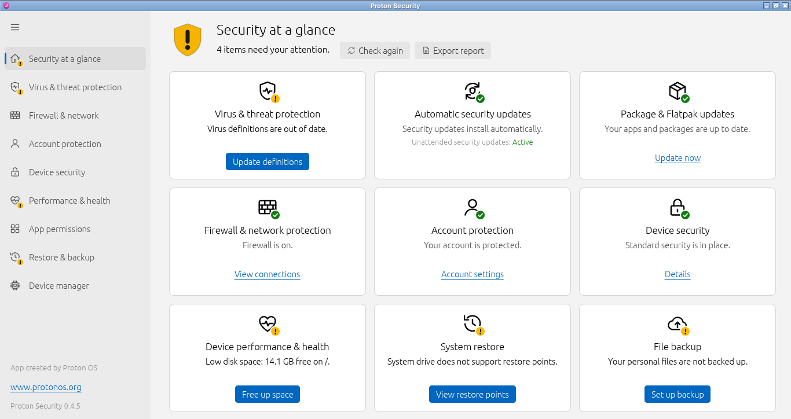
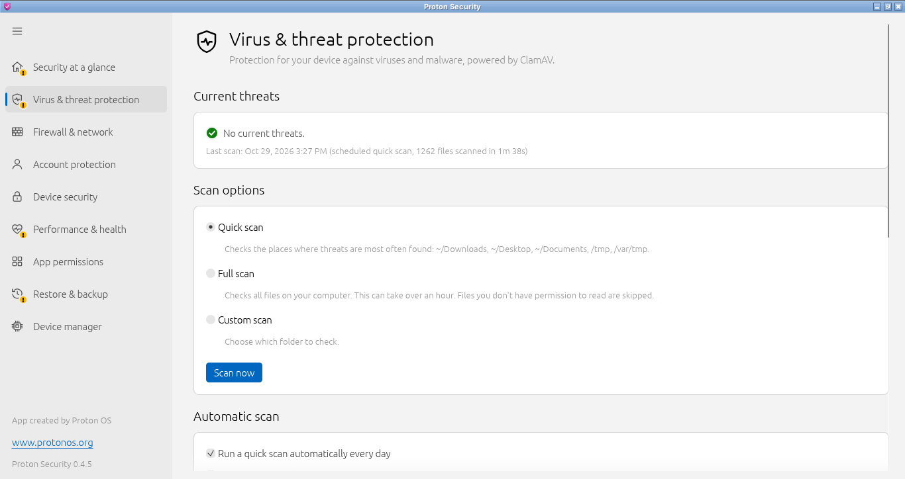
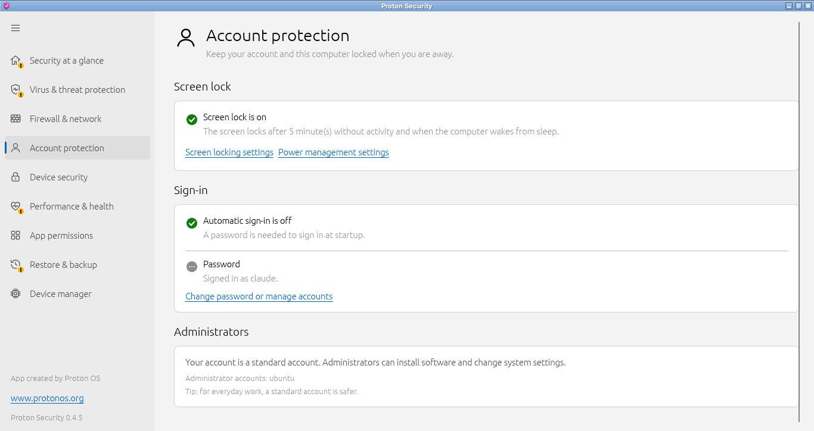
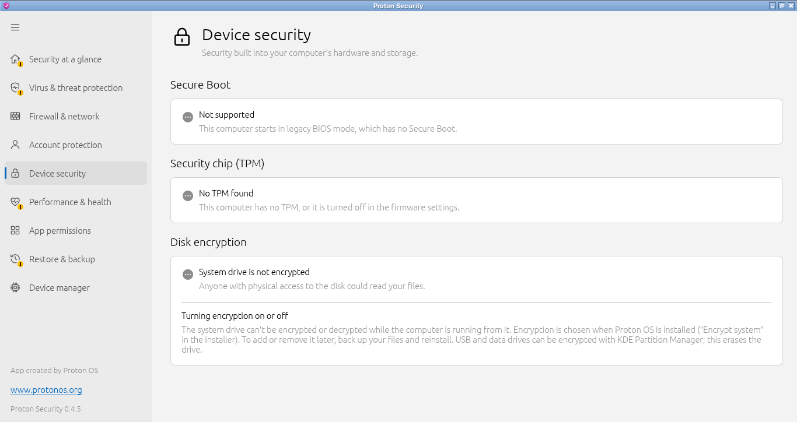
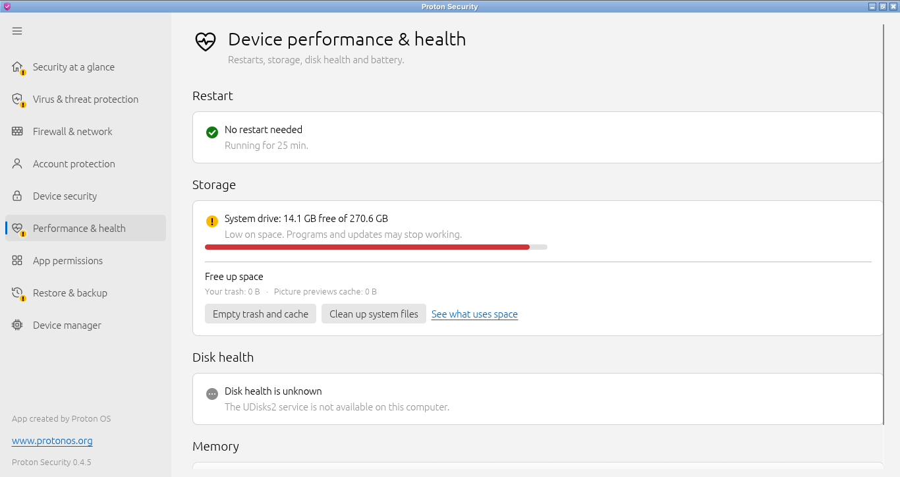
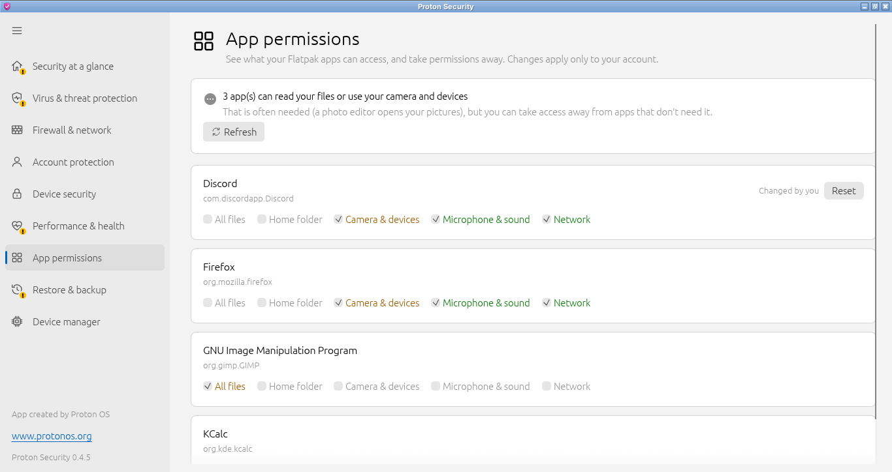
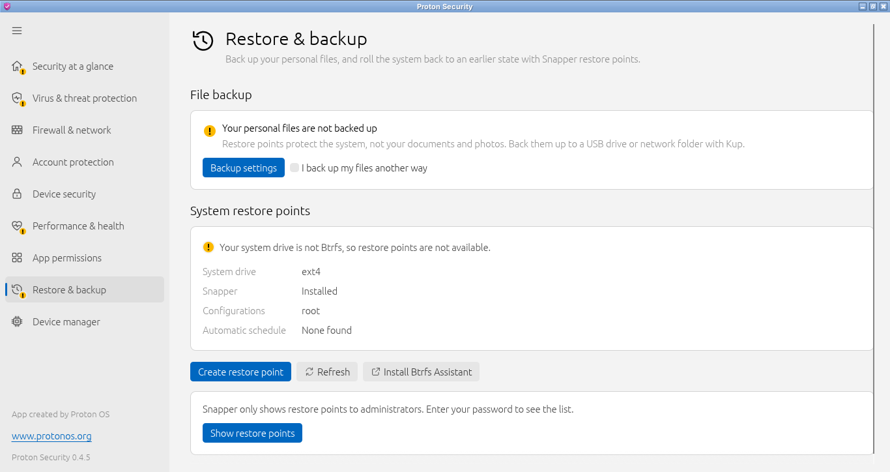
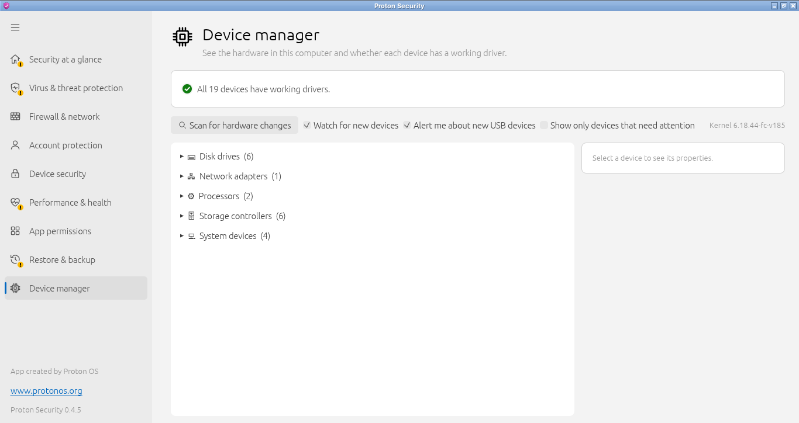
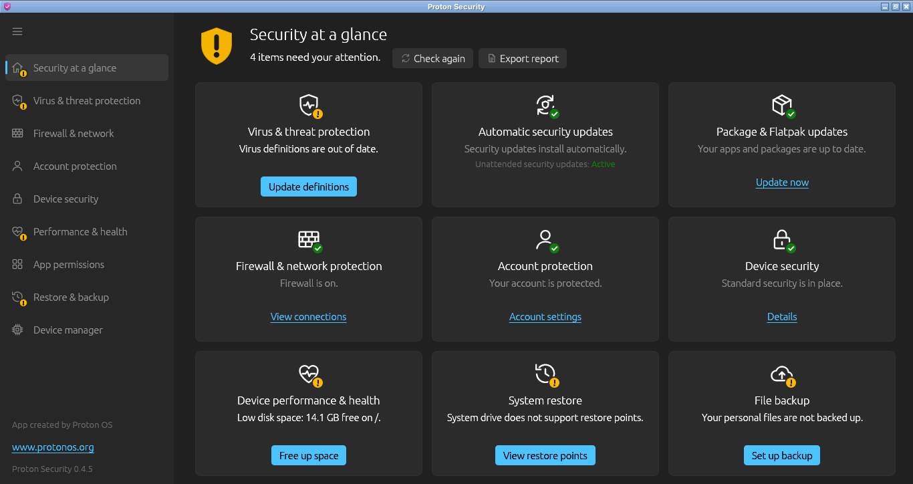

<div align="center">


# Proton Security

**A Windows Security–style security center for Linux desktops.**

Built for [Proton OS](https://www.protonos.org) (Debian 13 + KDE Plasma) to help people coming from Windows
keep their computer safe, without learning the terminal.

[](https://github.com/ProtonOS-Linux/proton-security-app/actions/workflows/ci.yml)
[](LICENSE)




</div>

---

## Contents

- [What it does](#what-it-does)
- [Screenshots](#screenshots)
- [Install](#install)
- [Build from source](#build-from-source)
- [Using it](#using-it)
- [How it works](#how-it-works)
- [Documentation](#documentation)
- [Contributing](#contributing)
- [Security](#security)
- [License](#license)

## What it does

Proton Security puts the security status of the whole computer on one screen. Each area is a tile with a
**green check** when all is well or a **yellow "!"** when something needs attention, plus a button that fixes it.
A shield icon in the system tray shows the same status at all times.

| Area | What it checks | What it can do |
|---|---|---|
| **Virus & threat protection** | ClamAV installed, virus definitions up to date, a recent scan, no open threats | Quick / full / custom scans, quarantine, daily automatic scan, checks every new download and new files on the desktop and in temporary folders (programs and scripts first), re-checks the last week's files after definition updates, warns when a program sets itself to start automatically, checks every USB drive you open |
| **Automatic security updates** | `unattended-upgrades` installed and running | Turn it on |
| **Package & Flatpak updates** | Packages and Flatpak apps updated in the last 30 days, automatic updates on | Update now, turn on automatic updates |
| **Firewall & network** | UFW or firewalld on | Turn it on; see which programs use the network; allow or block ports and addresses; firewall log |
| **Account protection** | Password set, no automatic sign-in, screen locks within 15 minutes and after sleep, the battery menu's "block screen locking" switch | Turn on the screen lock, turn off automatic sign-in |
| **Device security** | Secure Boot, TPM, disk encryption | Create a disk recovery key, change the disk password, back up the encryption header |
| **Performance & health** | Pending restart (or 15+ days without one), disk space, disk health and bad sectors, battery wear | Restart, empty trash, clean up system files |
| **System restore** | Btrfs + Snapper restore points made automatically | Turn on, list and create restore points, open Btrfs Assistant |
| **File backup** | A real backup tool (Kup, Déjà Dup, Pika, a backup timer) | Set up Kup |

Also: a **device manager** (drivers, missing firmware, update / reinstall / uninstall driver), **Flatpak app
permissions**, **USB device alerts** (a new "keyboard" could be a malicious USB stick), an exportable
**security report**, and a **company policy file** for organizations.

### Design principles

- **The app never runs as root.** Everything is checked as the signed-in user. Changes that need administrator
  rights go through one small, audited helper script, and only after you type your password
  (see [Security model](docs/SECURITY-MODEL.md)).
- **Plain language.** Every message is written for someone who has never used Linux.
- **Fits small screens.** "Security at a glance" never scrolls, even on a 1366×768 laptop.
- **Light and fast.** One native binary (Rust + [egui](https://github.com/emilk/egui)), no Qt or GTK toolkit;
  follows the system's light or dark theme.

## Screenshots

| | |
|---|---|
|  **Virus & threat protection** |  **Account protection** |
|  **Device security** |  **Performance & health** |
|  **App permissions** |  **Restore & backup** |
|  **Device manager** |  **Dark theme** |

## Install

Proton OS ships Proton Security preinstalled. On another Debian 13 (or newer) system with KDE Plasma, download
the `.deb` from the [latest release](https://github.com/ProtonOS-Linux/proton-security-app/releases/latest) and run:

```bash
sudo apt install ./proton-security_*_amd64.deb
```

`apt` also installs the recommended tools (ClamAV, Snapper, UFW, unattended-upgrades, Kup…). The tray icon
starts immediately and at every login.

To remove it:

```bash
sudo apt remove proton-security      # keep your settings
sudo apt purge proton-security       # also remove system leftovers
```

Your own settings and scan history live in `~/.config/proton-security` and `~/.local/share/proton-security`;
delete those folders to remove them too.

## Build from source

You need **Rust 1.95 or newer** (Debian's packaged `rustc` is older, so use [rustup](https://rustup.rs)):

```bash
sudo apt install build-essential curl pkg-config
curl --proto '=https' --tlsv1.2 -sSf https://sh.rustup.rs | sh
source ~/.cargo/env

git clone https://github.com/ProtonOS-Linux/proton-security-app.git
cd proton-security-app
cargo build --release              # binary: target/release/proton-security
cargo install cargo-deb
cargo deb                          # package: target/debian/proton-security_<version>-1_amd64.deb
```

A debug build (`cargo run`) also works without installing anything; administrator actions then use the helper
script from `packaging/`. See [docs/DEVELOPMENT.md](docs/DEVELOPMENT.md) for the test switches that let you try
every screen on any machine.

## Using it

Open **Proton Security** from the application menu, or click the shield in the system tray.

```text
proton-security                     open "Security at a glance"
proton-security --antivirus         open a page directly; also --firewall, --account,
                                    --device-security, --health, --apps, --restore, --devices
proton-security --report [file]     write the security report (HTML) and print its path
proton-security --diagnose          print what every check sees (attach this to bug reports)
proton-security --tray              the tray icon and background protection (started at login)
proton-security --scheduled-scan    run one quick scan without a window
proton-security --version           print the version
```

`PROTON_SECURITY_THEME=light` or `=dark` forces a theme.

## How it works

```text
 ┌──────────────── your desktop session (runs as you) ────────────────┐
 │                                                                    │
 │  proton-security            proton-security --tray                 │
 │  the window                 tray icon + background protection      │
 │   • runs the checks          • status icon, re-checks on changes   │
 │   • shows the pages          • scans new files and USB drives      │
 │                              • daily quick scan                    │
 │          │  both read the system as a normal user                  │
 └──────────┼─────────────────────────────────────────────────────────┘
            │ only when you click a fix that needs it
            ▼
   pkexec ──► polkit asks for the administrator password
            ▼
   /usr/libexec/proton-security/proton-security-helper <command> [args]
   (a short, whitelisted shell script: the only code that runs as root;
    commands that lower protection use its "-protected" name and always ask again)
```

[docs/ARCHITECTURE.md](docs/ARCHITECTURE.md) explains the code layout, and
[docs/SECURITY-MODEL.md](docs/SECURITY-MODEL.md) lists every helper command with the checks it performs.

## Documentation

| Document | For |
|---|---|
| [docs/CHECKS.md](docs/CHECKS.md) | Exactly when each tile is green or yellow, and what each fix does |
| [docs/ARCHITECTURE.md](docs/ARCHITECTURE.md) | How the code is organized, processes, files on disk |
| [docs/SECURITY-MODEL.md](docs/SECURITY-MODEL.md) | Privileges, the helper's commands, how secrets are handled |
| [docs/POLICY.md](docs/POLICY.md) | Company policy file for administrators |
| [docs/DEVELOPMENT.md](docs/DEVELOPMENT.md) | Building, testing, debug switches, screenshots |
| [docs/PACKAGING.md](docs/PACKAGING.md) | The `.deb`, installer scripts, adding it to an ISO |
| [CHANGELOG.md](CHANGELOG.md) | What changed in each version |

## Contributing

Bug reports, ideas and pull requests are welcome. Please read [CONTRIBUTING.md](CONTRIBUTING.md) first, and
follow our [Code of Conduct](CODE_OF_CONDUCT.md).

## Security

Please **do not** report security problems in public issues. See [SECURITY.md](SECURITY.md) for how to report
them privately.

## License

Proton Security is free software: you can redistribute it and/or modify it under the terms of the
**GNU General Public License, version 3 or (at your option) any later version**. See [LICENSE](LICENSE).

Copyright © 2026 Proton OS contributors. The icons are original artwork, released under the same license.
Proton Security is an independent project and is not affiliated with Microsoft; "Windows Security" is mentioned
only to describe the kind of app it is.
